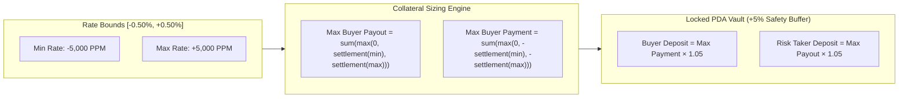
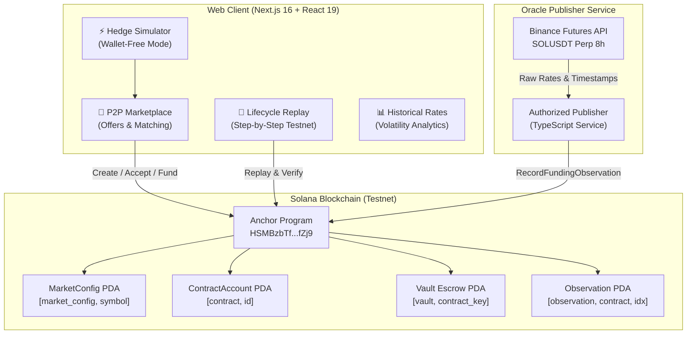
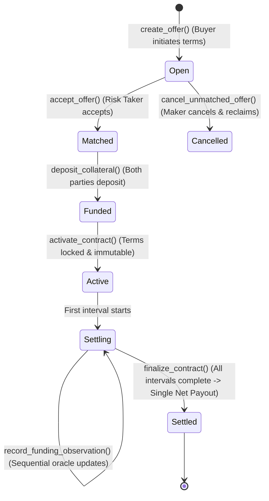

# 🔒 FundingLock (Solana v1)

> **Decentralized, Peer-to-Peer Funding-Rate Hedging Protocol on Solana.**  
> Lock in predictable funding costs for perpetual futures positions without moving your collateral off-exchange.

[](https://funding-lock-solana-v1.vercel.app/)
[](https://github.com/Suryashish/FundingLock-solana-v1)
[](https://explorer.solana.com/address/HSMBzbTfQQgLKk9Bv7d9WkLiK1yvKCs9FkeGgBhgfZj9?cluster=testnet)
[](https://github.com/Suryashish/FundingLock-solana-v1/tree/main/contract)
[](https://funding-lock-solana-v1.vercel.app/)

---

## 📌 Executive Summary & Problem Statement

### The Problem: Volatile, Bleeding Funding Rates
In cryptocurrency perpetual futures (*perps*), traders do not hold expiring contracts. To keep perpetual contract prices tethered to the underlying spot index, exchanges (Binance, Bybit, OKX, Drift, Jupiter) enforce **periodic funding rate payments** (typically every 8 hours) exchanged directly between long and short traders:

```
┌────────────────────────────────────────────────────────────────────────┐
│                        THE PERPETUAL FUNDING DILEMMA                   │
├────────────────────────────────────────────────────────────────────────┤
│  Bull Market Surge (+0.10% to +0.35% / 8hr)                            │
│  ➜ Longs pay shorts up to 100%–380% annualized fees                    │
│  ➜ Massive profit bleed & unexpected margin depletion                  │
│                                                                        │
│  Bear Market Rout (-0.05% to -0.20% / 8hr)                             │
│  ➜ Shorts pay longs steep borrowing costs                              │
│                                                                        │
│  ❌ Major Exchanges Offer ZERO Fixed-Rate Funding Instruments          │
└────────────────────────────────────────────────────────────────────────┘
```

- **Delta-Neutral & Basis Traders** face unpredictable yields that can flip negative overnight.
- **Directional Trend Traders** hold winning positions while their PnL is cannibalized by compounding funding payments.
- **No Native Solution:** Exchanges only provide variable-rate funding recalculated dynamically every epoch.

---

### The Solution: FundingLock
**FundingLock** is an on-chain, fixed-for-floating funding rate swap protocol. It enables traders to lock in an immutable, fixed funding rate for a specific duration through a bilateral, collateralized escrow contract on Solana.

```
+-----------------------------------------------------------------------------------------+
|                                    FUNDINGLOCK AT A GLANCE                              |
+-----------------------------------------------------------------------------------------+
|                                                                                         |
|   1. KEEP YOUR PERP WHERE IT IS                                                         |
|      FundingLock never touches, manages, or liquidates your exchange perpetual position.|
|      You trade on Binance, Drift, Bybit, or Jupiter as usual.                           |
|                                                                                         |
|   2. AGREE ON A FIXED RATE (e.g. 0.02% / 8hr)                                           |
|      Protection Buyer locks in predictable funding costs with a Risk Taker.             |
|                                                                                         |
|   3. ON-CHAIN RECORDING & NET FINAL SETTLEMENT                                          |
|      FundingLock ingests verified funding observations, accumulates signed              |
|      differences, and executes a single net payout at maturity.                         |
|                                                                                         |
+-----------------------------------------------------------------------------------------+
```

---

## 🎯 Target Use Cases

```
                                  FUNDINGLOCK MARKETPLACE
                                             │
                   ┌─────────────────────────┴─────────────────────────┐
                   ▼                                                   ▼
       🛡️ PROTECTION BUYER                                  📈 RISK TAKER / YIELD SEEKER
    (Long / Short Perp Trader)                              (Market Maker / Arbitrageur)
 ┌──────────────────────────────────────┐            ┌──────────────────────────────────────┐
 │ • Wants predictable funding costs   │            │ • Underwrites funding volatility     │
 │ • Converts floating rate to fixed   │   Match    │ • Collects attractive fixed premiums │
 │ • Compensated if funding surges     │ ◄────────► │ • Profits if realized rate stays low │
 │ • Retains position on native venue  │            │ • 100% collateral-backed solvency    │
 └──────────────────────────────────────┘            └──────────────────────────────────────┘
```

1. **Cash & Carry / Basis Trading Desks:** Lock in exact net yields on SOL spot-vs-perp basis trades without fearing sudden market euphoric funding spikes.
2. **Directional Swing Longs:** Protect multi-day or multi-week bull runs from paying upwards of 100%+ APR in perp borrow fees.
3. **Yield-Seeking Liquidity Providers:** Underwrite funding risk by accepting fixed rates that exceed expected statistical averages.
4. **Treasury Management:** Crypto DAOs and institutions holding delta-hedged inventory can forecast exact operational costs.

---

## ⚡ Live Links & Deployment Details

| Resource | Link / Identifier | Description |
| :--- | :--- | :--- |
| 🌐 **Live Web Application** | [funding-lock-solana-v1.vercel.app](https://funding-lock-solana-v1.vercel.app/) | Interactive dApp with Simulator, Marketplace, & Explorer |
| 📦 **GitHub Repository** | [github.com/Suryashish/FundingLock-solana-v1](https://github.com/Suryashish/FundingLock-solana-v1) | Open source smart contract, dApp, and oracle scripts |
| ⛓️ **Solana Program ID** | [`HSMBzbTfQQgLKk9Bv7d9WkLiK1yvKCs9FkeGgBhgfZj9`](https://explorer.solana.com/address/HSMBzbTfQQgLKk9Bv7d9WkLiK1yvKCs9FkeGgBhgfZj9?cluster=testnet) | Anchor program deployed on Solana Testnet |
| 📊 **Default Market** | `SOL-PERP` (`BINANCE_PERP`) | Normalized 8-hour UTC funding epochs |
| 🪙 **Collateral Asset** | Native Testnet SOL (1 cent = 100,000 lamports) / SPL USDC compatible | Fully collateralized PDA escrow vault |

---

## 🧮 Mathematical Engine & Direction-Aware Settlement

FundingLock eliminates floating-point rounding errors across Rust contracts and TypeScript clients by adopting integer fixed-point arithmetic using **Parts-Per-Million (PPM)**:
$$\text{Scale: } 1,000,000\text{ PPM} \quad \left(1\% = 10,000\text{ PPM}, \quad 0.01\% = 100\text{ PPM} = 1\text{ bps}\right)$$

### Direction Sign ($s$)
The protocol natively supports both long and short hedges via direction sign $s$:
$$s = \begin{cases} +1 & \text{for Long-position hedge (pays when rate } > 0) \\ -1 & \text{for Short-position hedge (pays when rate } < 0) \end{cases}$$

### Interval Formulas (for Interval $i$)
1. **Actual Funding Cost on Exchange:**
   $$\text{actual\_funding\_cost}_i = s \times \text{notional} \times \text{realized\_rate}_i$$
2. **Agreed Fixed Target Cost:**
   $$\text{fixed\_funding\_cost}_i = s \times \text{notional} \times \text{fixed\_rate}$$
3. **Interval Settlement (Owed to Protection Buyer):**
   $$\text{interval\_settlement}_i = s \times \text{notional} \times (\text{realized\_rate}_i - \text{fixed\_rate})$$
4. **Total Accumulated Settlement at Maturity:**
   $$\text{total\_settlement} = \sum_{i=1}^{N} \text{interval\_settlement}_i$$
5. **Effective Net Funding Cost to Trader:**
   $$\text{net\_funding\_cost} = \text{actual\_funding\_cost} - \text{total\_settlement} \equiv \text{fixed\_funding\_cost}$$

---

### Concrete 7-Day Demonstration ($10,000 SOL-PERP)

Let's illustrate with the baseline 7-day scenario (21 eight-hour intervals) with a **$10,000 notional**, **0.02% agreed fixed rate**, and a sustained **0.10% realized funding rate**:

```
┌──────────────────────────────────────────────────────────────────────────────────┐
│                           WITHOUT FUNDINGLOCK (UNHEDGED)                         │
├──────────────────────────────────────────────────────────────────────────────────┤
│  • 21 intervals × $10,000 × +0.10% = $210.00 actual funding paid to exchange     │
│  • Total Out-of-Pocket Expense: $210.00                                          │
└──────────────────────────────────────────────────────────────────────────────────┘
                                      ▼
┌──────────────────────────────────────────────────────────────────────────────────┐
│                            WITH FUNDINGLOCK (HEDGED)                             │
├──────────────────────────────────────────────────────────────────────────────────┤
│  1. Trader pays $210.00 on Binance/Exchange                                      │
│  2. FundingLock contract calculates difference per interval:                     │
│     Δ = $10,000 × (0.10% - 0.02%) = $8.00 per interval                          │
│  3. Total Settlement from Vault to Trader: 21 × $8.00 = +$168.00                │
│  4. Resulting Net Funding Cost: $210.00 - $168.00 = $42.00                       │
│     (Exactly equal to 21 intervals × $10,000 × 0.02% fixed rate!)                │
└──────────────────────────────────────────────────────────────────────────────────┘
```

---

## 🛡️ 100% Solvency & Bounded Collateral Model

A critical flaw in naive derivative protocols is relying on historical rate averages or dynamic margin calls that risk bad debt during sudden liquidity crunches.

**FundingLock guarantees 100% solvency** by calculating collateral strictly from **worst-case mathematical bounds** $[\text{min\_rate}, \text{max\_rate}]$ plus an explicit safety buffer:



- **No Liquidation Cascades:** Collateral is locked upfront for the duration of the contract in a PDA escrow.
- **Zero Insolvent Contracts:** The vault holds sufficient funds to cover any combination of observations within verified market boundaries.
- **Atomic Capital Release:** Remaining excess collateral + net settlements are atomically disbursed at finalization.

---

## 🏛️ System Architecture



---

## 🔄 Contract Lifecycle State Machine

The on-chain Anchor contract enforces a deterministic, irreversible state machine:



### State Breakdown
1. **`Open`:** Protection buyer creates an offer specifying market, notional, fixed rate, and duration.
2. **`Matched`:** Risk taker commits to taking the counter-position.
3. **`Funded`:** Both parties deposit their pre-calculated collateral into the contract's PDA Vault.
4. **`Active`:** Contract terms become strictly immutable; contract clock begins.
5. **`Settling`:** Authorized oracle publishes sequential funding rate observations. Accounting is updated with zero interim token transfers.
6. **`Settled`:** Once all observations are confirmed, `finalize_contract` transfers net settlement and unlocks remaining collateral in one transaction.

---

## 📁 Repository Structure

```text
FundingLock-solana-v1/
├── contract/                          # Solana Anchor Program (Rust)
│   ├── programs/contract/src/
│   │   ├── constants.rs               # PDA seeds, scale constants (1e6 PPM, 100k lamports/cent)
│   │   ├── errors.rs                  # Custom program errors (ErrorCode)
│   │   ├── instructions/
│   │   │   ├── accept_offer.rs        # Accept open offer
│   │   │   ├── activate_contract.rs   # Activate fully funded contract
│   │   │   ├── cancel_unmatched_offer.rs # Cancel & refund open offer
│   │   │   ├── create_offer.rs        # Create offer & initialize PDA
│   │   │   ├── deposit_collateral.rs  # Lock SOL in PDA vault
│   │   │   ├── finalize_contract.rs   # Net settlement calculation & capital release
│   │   │   ├── initialize_market.rs   # Initialize venue & bounds configuration
│   │   │   ├── pause_market.rs        # Circuit breaker authority controls
│   │   │   └── record_funding_observation.rs # Validate & log interval rate
│   │   ├── state/
│   │   │   ├── contract_account.rs    # Core contract state & accounting struct
│   │   │   ├── market_config.rs       # Market venue, oracle authority, rate bounds
│   │   │   └── observation_record.rs  # Per-interval observation archive
│   │   └── lib.rs                     # Anchor program declaration & instruction router
│   ├── Anchor.toml                    # Anchor workspace configuration
│   └── Cargo.toml
├── docs/                              # Formal Protocol Specifications
│   ├── contract-spec.md               # On-chain accounts, instructions & accounting spec
│   ├── oracle-spec.md                 # Venue normalization, PPM scale & validation rules
│   └── threat-model.md                # Counterparty risk, oracle assumptions & mitigations
├── scripts/
│   └── funding-publisher.ts           # Standalone off-chain testnet oracle publisher
├── website/                           # Next.js 16 Web Application & Trading Suite
│   ├── app/
│   │   ├── (workspace)/               # Dedicated Trading Suite Views
│   │   │   ├── contract-flow/         # Step-by-step contract lifecycle debugger
│   │   │   ├── marketplace/           # Peer-to-peer open funding offers board
│   │   │   ├── protocol/              # Protocol mechanics, threat model & FAQ
│   │   │   ├── rates/                 # Historical funding rate tracker & volatility
│   │   │   └── simulator/             # Interactive wallet-free hedge calculator
│   │   ├── globals.css                # Tailwind styling & dark mode design tokens
│   │   ├── layout.tsx                 # Root layout & wallet provider wrapper
│   │   └── page.tsx                   # Interactive landing page with live hero visualizer
│   ├── components/
│   │   ├── ApplicationUI.tsx          # Reusable design system (Panels, Dialogs, Badges)
│   │   ├── FundingCostChart.tsx       # SVG cash-flow & cumulative settlement chart
│   │   ├── HedgeSimulator.tsx         # Pure calculation simulator component
│   │   ├── HeroFundingVisual.tsx      # Real-time visual comparing floating vs fixed cost
│   │   ├── HistoricalDashboard.tsx    # 30-day SOL-PERP historical data viewer
│   │   ├── MarketplaceBoard.tsx       # P2P marketplace board with wallet integration
│   │   ├── ReplayDemo.tsx             # Interactive contract step runner on Solana Testnet
│   │   └── WalletContextProvider.tsx  # Solana wallet adapter integration
│   ├── lib/
│   │   ├── data/fixtures.ts           # 30-day historical rates & scenario presets
│   │   ├── domain/                    # Pure TypeScript Calculation Engine
│   │   │   ├── collateral.ts          # Bound-based collateral & solvency mathematics
│   │   │   ├── funding.ts             # Direction-aware settlement equations
│   │   │   ├── types.ts               # Universal domain types & market configurations
│   │   │   └── validation.ts          # Input sanitization and boundary constraints
│   │   └── solana/
│   │       ├── client.ts              # Anchor instruction builders & PDA derivation
│   │       └── transactions.ts        # RPC simulation, broadcasting & state fetching
│   └── package.json
└── plan.md                            # Comprehensive system implementation plan
```

---

## 💻 Frontend Application Modules

The deployed web application at [funding-lock-solana-v1.vercel.app](https://funding-lock-solana-v1.vercel.app/) provides four core trading and analysis workspaces:

### 1. ⚡ Hedge Calculator & Simulator (`/simulator`)
- **100% Wallet-Free:** Experiment with hedge terms without connecting a wallet or spending testnet SOL.
- **Scenario Presets:**
  - *Baseline Scenario:* Stable 0.10% funding with verifiable $42 net cost.
  - *Bullish High Funding:* Simulates bull market runs with rates up to +0.22% per interval.
  - *Bearish Negative Funding:* Simulates short squeeze markets with negative rates down to -0.09%.
  - *Volatility Spike:* Simulates sudden extreme volatility jumps up to +0.35%.
- **Interactive Dual Charts:** Visual comparison between unhedged cumulative expenses vs hedged fixed costs.
- **One-Click Carryover:** Send customized simulation terms directly into the Marketplace offer creation form.

### 2. 🤝 Peer-to-Peer Marketplace (`/marketplace`)
- Live board displaying active, open, and settled funding rate contracts.
- **Create Offer:** Input notional, fixed rate, and duration; the engine automatically computes exact required collateral for both counterparties.
- **Accept Offer:** Match compatible offers with a single Solana wallet transaction.
- Status filters for browsing Open, Matched, and Active contracts.

### 3. 🔄 Contract Lifecycle Replay (`/contract-flow`)
- Step-by-step interactive runner demonstrating the complete on-chain lifecycle.
- Execute real testnet transactions: Create $\rightarrow$ Accept $\rightarrow$ Deposit $\rightarrow$ Activate $\rightarrow$ Record Observations $\rightarrow$ Finalize.
- Inspect Solana Explorer transaction links and PDA states in real time.

### 4. 📊 Historical Funding Rates (`/rates`)
- Multi-timeframe historical funding rate viewer (7, 14, and 30-day windows) for Binance `SOL-PERP`.
- Real-time volatility indicators: Mean Rate, Max Rate, Standard Deviation, and Annualized Percentage.
- Direct "Simulate from Historical Data" feature to backtest hedges against real past market conditions.

---

## 🔒 Security Architecture & Threat Model

| Vector | Threat Description | Protocol Mitigation |
| :--- | :--- | :--- |
| **Insolvency / Bad Debt** | Realized rates spike beyond collateral pool. | Collateral is sized from theoretical worst-case rate bounds $[\text{min\_rate}, \text{max\_rate}]$ plus safety buffer, **never** historical averages. |
| **Premature Withdrawal** | Participant pulls collateral before contract expiry. | Collateral is held in a program-derived address (PDA) vault; withdrawals are strictly prevented until finalization. |
| **Price Risk Confusion** | Trader assumes hedge covers underlying SOL price drops. | Explicit disclosures in UI that the protocol hedges **funding-rate risk only**, not underlying spot price. |
| **Oracle Manipulation** | Oracle submits anomalous or malicious rate spikes. | On-chain contracts enforce hard minimum/maximum rate bounds ($[-0.50\%, +0.50\%]$) and require authorized publisher signatures. |
| **Missing Observation Freeze** | Oracle misses an interval due to downtime. | Missing observations halt finalization rather than defaulting to zero, preserving auditability and contract solvency. |
| **Double Settlement** | Exploiter attempts to finalize a settled contract twice. | Strict state transitions enforce finalization occurs exclusively from `Settling` into `Settled`. |

---

## 🚀 Local Development & Quickstart

### Prerequisites
- [Node.js](https://nodejs.org/) (v18+ or v20+) and [pnpm](https://pnpm.io/)
- [Rust](https://www.rust-lang.org/) (v1.75+)
- [Solana CLI](https://docs.solanalabs.com/cli/install) (v1.18+)
- [Anchor CLI](https://www.anchor-lang.com/docs/installation) (v0.30+)

---

### 1. Web Application Setup

```bash
# Clone the repository
git clone https://github.com/Suryashish/FundingLock-solana-v1.git
cd FundingLock-solana-v1/website

# Install dependencies
pnpm install

# Run the local development server
pnpm dev
```
Open [http://localhost:3000](http://localhost:3000) to view the dApp.

---

### 2. Anchor Smart Contract Build & Test

```bash
cd ../contract

# Build the Solana program
anchor build

# Run unit tests
cargo test
```

---

### 3. Oracle Publisher Service (Testnet)

```bash
# From repository root
cd scripts

# Set environment variables (optional: uses dry-run / ephemeral keys by default)
export SOLANA_RPC_URL="https://api.testnet.solana.com"
export CONTRACT_ID="FL-SOL-001"
export SCENARIO_NAME="baseline"
export PUBLISHER_SECRET_KEY="[...keypair json array...]"

# Execute the publisher
npx ts-node funding-publisher.ts
```

---

## 🗺️ Roadmap & Future Enhancements

- [x] **v1.0 (Current):**
  - Anchor smart contract deployed on Solana Testnet.
  - Native SOL collateral with fixed-point PPM settlement arithmetic.
  - Binance `SOL-PERP` 8-hour normalized oracle publisher.
  - Next.js dApp featuring wallet-free simulator, marketplace, and lifecycle replay.
- [ ] **v1.1:**
  - Support for SPL USDC native collateral.
  - Two-way short-position hedge initiation on-chain.
- [ ] **v2.0:**
  - Multi-venue funding rate indexing (Binance, Bybit, Hyperliquid, Drift, OKX).
  - Decentralized oracle feeds via Switchboard / Pyth on-demand benchmarks.
  - Automated liquidity pools (AMM) for instant fixed-rate hedge matching.

---

## 📄 License & Attribution

This project is licensed under the **MIT License**.  
Developed for the Solana Ecosystem by [@Suryashish](https://github.com/Suryashish).

*Disclaimer: FundingLock is a testnet prototype built for educational and demonstration purposes. It is not financial advice and has not yet undergone a third-party security audit for mainnet production funds.*

